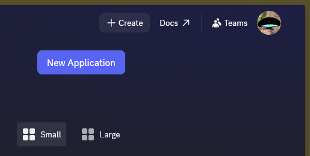
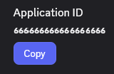
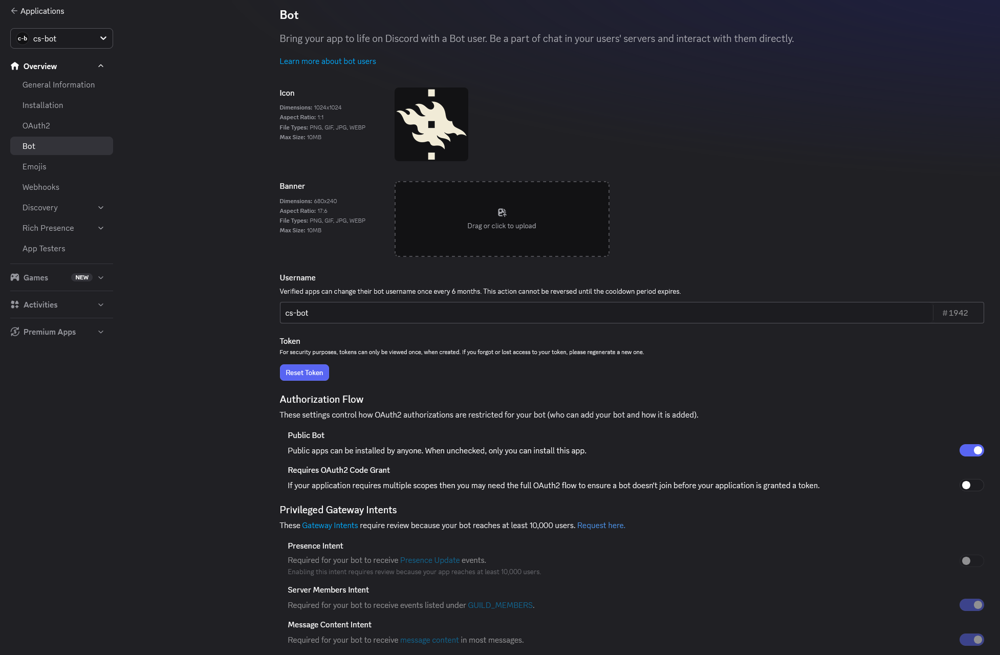
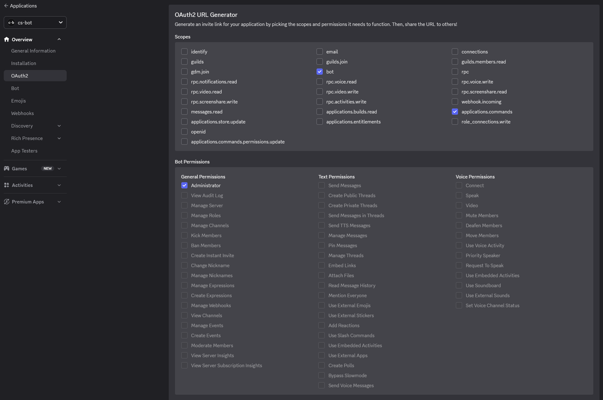

# Setting up the bot application

## Create your bot

You need a Discord account and a server to run the bot in. Put the server's ID in `.env` as `GUILD_ID` and a permanent invite link to it as `DISCORD_SERVER_INVITE`.

Next go to the [developers application page](https://discord.com/developers/applications) and follow these instructions.

On the main view click the "New Application" button



Next give your Bot a name and click the "Create" button.

On the "General Information" tab, copy the `Application ID` by pressing the `Copy` button.



```
Add this to `.env` file : BOT_ID=id-of-your-bot.
```

Every new application comes with a bot user, so there is nothing to add. Go to the "Bot" tab.



Under Privileged Gateway Intents put `Server Members Intent` and `Message Content Intent` on and save your changes. `Presence Intent` is not needed.

Discord only shows the token once, when it is created. Click the "Reset Token" button and confirm to generate a new token, then copy it right away. If you lose it, reset it again.

```
Add this token to `.env` file : DISCORD_BOT_TOKEN=your-own-token.
```

## Connect your bot to your Discord server

To connect your Bot to your Discord server, you need to create an invite URL. Go to the "OAuth2" tab and scroll down to the "OAuth2 URL Generator".



Under `Scopes` select **bot** and **applications.commands**, and under `Bot Permissions` select **Administrator**. Copy the generated URL at the bottom and paste it to your browser. Choose the server you want to invite your Bot to.
