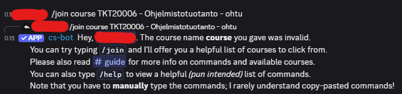
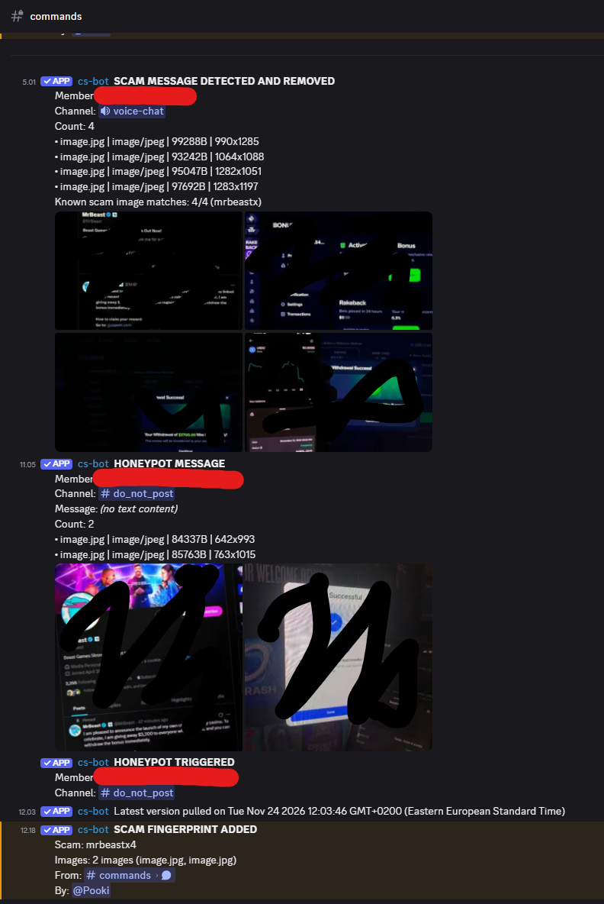
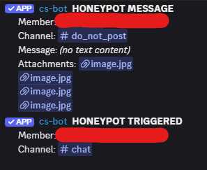

# Privileged intent verification answers
**Date:** 27/11/2026

The answers given in Discord's privileged intent application in the Developer Portal, in the form's order. Text answers have a 2000 character limit.

## Application Details

### A1. What does your application do? Please be as detailed as possible, and feel free to include links to image or video examples.

```text
CS Discord Bot is a private, open-source course-management bot run by the University of Helsinki for one server: the Department of Computer Science Discord. It only works in our guild (the guild ID is fixed in its configuration).

The server has channels for each university course, used by students, volunteer instructors and faculty. Students only see the courses they join:
- Enrollment: /join and /leave, or the Join and Leave buttons on each course in an auto-generated #guide channel. The bot gives or removes the course role. Links on Moodle course pages go to our website, which adds the student to the server and the course (OAuth, identify + guilds.join).
- Faculty tools: verified teachers (checked with university single sign-on) create and manage their courses with slash commands: channels, chat locks, instructor roles, polls. They don't need to know how Discord roles work, which is why we don't use Discord's Onboarding.
- Admin tools: checking and restoring roles and course structure from our database, and a "Kick user" message menu command that kicks a message's author with a reason sent to them.
- Spam/scam protection: a honeypot channel, and a check of image attachments against known scam images posted by compromised accounts. Confirmed hits are deleted, the account is sent password-reset steps and kicked (a ban that is lifted automatically a minute later). Staff accounts are not kicked: their message is deleted and the admins are pinged.

All commands are slash commands, plus two admin-only message menu commands. Since our last request we removed the copy-pasted command handling, stopped storing anything when someone joins the server, replaced the #guide reactions with buttons, and replaced member-cache lookups with interaction data, single-member fetches and our database. Admins can delete records of users who have no courses or staff role left.

Source: https://github.com/UniversityOfHelsinkiCS/cs-discord-bot
```

The removed copy-pasted command handling, which read message text to answer commands typed as plain messages:



### Do you have a public Privacy Policy telling your users about their data usage?

- [x] Yes
- [ ] No

#### A2. Where is your Privacy Policy available?

```text
The Privacy Policy is in the bot's public GitHub repository: https://github.com/UniversityOfHelsinkiCS/cs-discord-bot/blob/main/PRIVACY_POLICY.md (full version history: https://github.com/UniversityOfHelsinkiCS/cs-discord-bot/commits/main/PRIVACY_POLICY.md). It is also linked from the server rules in our Discord guild. All members were notified in the server's #announcements channel when it was published, and changes to it (and to the Terms of Service) are announced there as well. The Terms of Service are in the same repository: https://github.com/UniversityOfHelsinkiCS/cs-discord-bot/blob/main/TERMS_OF_SERVICE.md
```

#### A3. Please share a link to your Privacy Policy.

```text
https://github.com/UniversityOfHelsinkiCS/cs-discord-bot/blob/main/PRIVACY_POLICY.md
```

## Privileged Gateway Intents

### Which intents are you applying for, if any? (Leave blank if you do not need any of these)

- [x] Server Members Intent
- [x] Message Content Intent

## Server Members Intent

### A4. Why do you need the Guild Members intent?

```text
WHAT WE USE IT FOR
1. Deleting data when someone leaves (GUILD_MEMBER_REMOVE). We store a user's Discord ID and username (encrypted) once they join a course or get a staff role. When they leave, are kicked or banned, the bot deletes that record and all their course memberships right away, and removes them from the instructor list of any course they taught. No REST endpoint or interaction tells us that a user has left.
2. Cleanup at startup (full member list). The bot compares stored users with the member list and deletes anyone who left while it was offline.
3. Admin role checks: /fix_course_roles, /server_status, /update_database and /restore_server_from_database compare every member's course roles with our database to fix or rebuild them after mistakes or outages.

WHAT WE ALREADY DO WITHOUT THE INTENT
- Nothing is stored when someone joins the server; we don't use the join event.
- Commands and buttons read the member from the interaction payload.
- Role changes fetch only the one member they need (Get Guild Member).
- Instructor lists come from our database, not the member list.
- We don't use presence data.
```

### A5. Please provide links to screenshots and/or videos that demonstrate your use case

```text
Screenshots (GitHub):
- Joining a course with /join, which gives the course role: https://github.com/UniversityOfHelsinkiCS/cs-discord-bot/blob/main/documentation/images/join.png
- Course channels showing after the role is added: https://github.com/UniversityOfHelsinkiCS/cs-discord-bot/blob/main/documentation/images/channels.png
- /instructors: https://github.com/UniversityOfHelsinkiCS/cs-discord-bot/blob/main/documentation/images/instructors.png

Code that uses the intent:
- Leave event, deletes the user's data: https://github.com/UniversityOfHelsinkiCS/cs-discord-bot/blob/main/src/discordBot/events/guildMemberRemove.js
- Startup cleanup of members who left while offline: https://github.com/UniversityOfHelsinkiCS/cs-discord-bot/blob/main/src/discordBot/events/ready.js
- Admin role check against the database: https://github.com/UniversityOfHelsinkiCS/cs-discord-bot/blob/main/src/discordBot/commands/admin/fix_course_roles.js

Manuals:
- Student: https://github.com/UniversityOfHelsinkiCS/cs-discord-bot/blob/main/documentation/usermanual-student.md
- Admin: https://github.com/UniversityOfHelsinkiCS/cs-discord-bot/blob/main/documentation/usermanual-admin.md

Our server: https://study.cs.helsinki.fi/discord
```


### Are you storing any API Data off-platform (outside of Discord)?

- [x] Yes
- [ ] No

#### Are you storing API Data for 30 days or less?

- [ ] Yes
- [x] No

#### A6. How do users contact you to request deletion of their activity data?

```text
Deletion is automatic when a user leaves the server: their user record and all course memberships are deleted from our database right away, and the bot also removes records of anyone no longer in the server every time it starts. Nothing is stored when someone joins the server; a record is created only when they join a course or are given a staff role. When the bot kicks someone, it briefly stores their Discord ID (encrypted) and when the ban is due to be lifted, so the unban survives a restart; that row is deleted once the ban is lifted, about a minute later.

Users can also ask for access, correction or deletion at any time by:
- messaging a server administrator on our Discord server (https://study.cs.helsinki.fi/discord),
- opening an issue on our GitHub repository (https://github.com/UniversityOfHelsinkiCS/cs-discord-bot/issues),
- emailing the person responsible for register matters, Matti Luukkainen (matti.luukkainen@helsinki.fi), or the University of Helsinki Data Protection Officer (tietosuoja@helsinki.fi).

These contacts are in section 8 of our Privacy Policy: https://github.com/UniversityOfHelsinkiCS/cs-discord-bot/blob/main/PRIVACY_POLICY.md. We keep data longer than 30 days because a record has to exist for as long as the user is a member and holds course roles. Encrypted database backups rotate out within one year.
```

#### Are you encrypting the data that you store at rest, as is required by our developer policy?

- [x] Yes
- [ ] No

## Message Content Intent

### Can users opt-out of having their message content data tracked?

- [ ] Yes
- [x] No

### Are you storing message content data off-platform (outside of Discord)?

- [ ] Yes
- [x] No

### Will the message content data be used to train machine learning or AI Models?

- [ ] Yes
- [x] No

### A7. Why do you need the Message Content intent?

```text
WHAT WE USE IT FOR
Only spam and scam protection. The bot has no text or prefix commands; everything is a slash command. Nothing from checked messages is stored in a database, and nothing is used for AI/ML.
1. Compromised-account image scams: hacked accounts post several images (fake crypto/casino giveaways). For messages with two or more images, the bot downloads a small preview of each image and reduces it in memory to a perceptual hash, which it compares with hashes of images our admins have marked as scams. Attachments are gated by this intent, and AutoMod can't inspect images.
   - Every image matches: the message is deleted, the account is kicked (a ban lifted a minute later, so it can rejoin; the wait lets Discord finish deleting its recent messages) and sent password-reset steps. Staff accounts are not kicked; their message is deleted and the admins are pinged.
   - Only some match, or four images match nothing: admins get a report for human review. It is held for one minute and dropped if the honeypot kicks the account in that time.
2. Honeypot: a channel says "do not post here". Spam bots post the same thing there and in #chat. The bot compares text and attachment names/sizes in those two channels only, kept in memory for at most an hour, and kicks accounts that post the same thing in both, or post in the honeypot twice. AutoMod can't link posts across two channels. Honeypot messages are deleted right away, so the admin report includes the text and attachments for human review.

The list of known scam images holds only hashes, a scam name and file names, nothing about who posted them. Admins add to it with a slash command or the "Add scam fingerprint" and "Kick user" message menu commands, which get the message from the interaction and don't need this intent.
```

### A8. Please provide links to screenshots and/or videos that demonstrate your use case

```text
Screenshots from our server (usernames censored):
- Scam detection: a confirmed scam removed automatically, and a near-miss only flagged to admins for human review: https://github.com/UniversityOfHelsinkiCS/cs-discord-bot/blob/main/documentation/verification/images/scam-detection.png
- Honeypot: the admin report for a post in #do_not_post, then the automatic kick when the same attachments were posted in #chat: https://github.com/UniversityOfHelsinkiCS/cs-discord-bot/blob/main/documentation/verification/images/honeypot-message-and-trigger.png

Code (public):
- Spam/scam detection, the only code that reads message content: https://github.com/UniversityOfHelsinkiCS/cs-discord-bot/blob/main/src/discordBot/services/firewall.js
- Image hashing and comparison with known scam images: https://github.com/UniversityOfHelsinkiCS/cs-discord-bot/blob/main/src/discordBot/services/scamImageMatcher.js
- Message handler, which only passes messages to the detection above: https://github.com/UniversityOfHelsinkiCS/cs-discord-bot/blob/main/src/discordBot/events/messageCreate.js

Our server: https://study.cs.helsinki.fi/discord
There you can see the #do_not_post honeypot channel with its pinned warning in Finnish, Swedish and English. The reports above go to an admin-only channel that regular members can't see.

Privacy Policy sections 2.1 and 2.5 describe how message content and images are used and what the bot does automatically: https://github.com/UniversityOfHelsinkiCS/cs-discord-bot/blob/main/PRIVACY_POLICY.md
```




